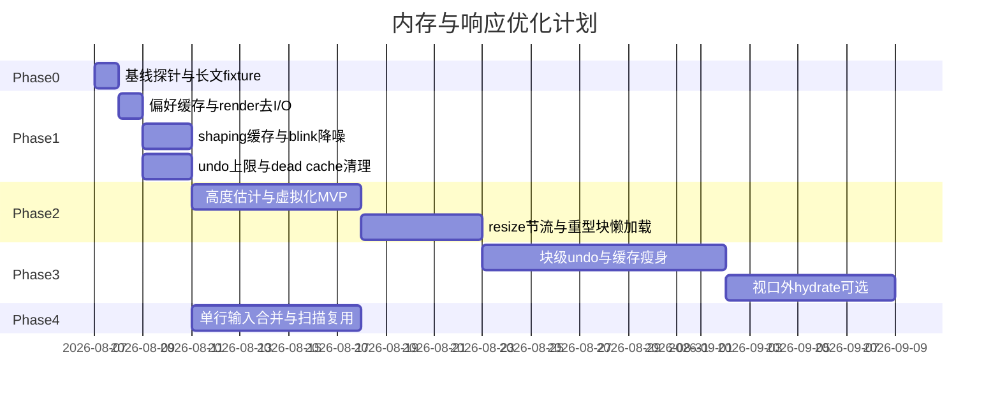

# 内存与响应性能优化方案

面向「打开文档常占 200MB+」与「长 Markdown 拖窗口卡顿」的专项计划。按 PR 分阶段推进；与 [代码重构执行计划](refactor-execution-plan.zh-CN.md) 互补——**本计划以内存与帧路径性能为第一目标**，结构清理不阻塞本计划 Phase 1–2。

[开发与构建](development.zh-CN.md) | [重构执行计划](refactor-execution-plan.zh-CN.md) | [重构队列使用说明](refactor-queue-usage.zh-CN.md)

---

## 执行原则

1. **先测再砍**：每阶段前后用同一长文 fixture、同一 **release** 构建对比 RSS 与拖窗口帧耗时
2. **帧路径零 I/O、零全文序列化**：`Editor::render` / layout / paint 禁止读配置文件、禁止无条件重建 source mapping
3. **只布局视口附近**：长文档第一杠杆是虚拟化，优先于单块微优化
4. **一份真相、派生可丢**：undo / render cache / display text 改为按需或差分，避免「每块 × 每字节映射 × 历史深度」
5. **一步一 PR**：便于 review 与回滚；提交消息简体中文，格式见 `.cursorrules`
6. **验收一律 release**：`cargo build --release` / `./scripts/run.sh`；debug 下 app 代码未优化会放大卡顿

---

## 1. 症状与根因

| 现象 | 主要根因 | 关键代码 |
| --- | --- | --- |
| 打开文档常 >200MB | 每块一个 GPUI `Entity`；`title` / `InlineRenderCache` / `cached_display_text` / projection 多份文本；undo 最多 200 份**全文**；tree-sitter 多语法；Mermaid/LaTeX/图片运行时 | `editor/mod.rs`、`components/markdown/inline/mod.rs`、`editor/history.rs`、`components/markdown/code_highlight.rs` |
| 长文档拖窗口明显延迟 | **所有块**每帧进滚动容器；宽度变 → 每块 `request_layout` 里 `shape_text`；`Editor::render` 每帧 `read_app_preferences()` 读盘+TOML；blink/`cx.notify` 触发整树重建 | `editor/render.rs`、`components/block/element.rs`、`config/store.rs` |

### 架构要点（现状）

- 无 rope / 增量 AST；Rendered 模式是块树 + 行内 fragment
- Source 模式会整篇序列化再塞进一个大段落（`window_state` 视图切换）
- `VisibleTreeSnapshot` 的「visible」是 DFS 展开顺序，**不是视口裁剪**
- `Editor::render`（约 `render.rs:1571+`）对全部 `visible_blocks` 构建子节点；偏好设置每帧 `read_app_preferences()`（约 `1574` 行附近）
- Undo：`HISTORY_LIMIT = 200`，条目含完整 `source_text`（`editor/mod.rs`、`history.rs`）
- `InlineRenderCache` 仍分配 `visible_to_tree` / `tree_to_visible`（标了 `dead_code` 仍占内存）

---

## 2. 目标指标

用同一份长文 fixture（建议：2k–5k 块，或 1–5 万行 Markdown）在 **release** 下测量。

| 指标 | 现状（经验） | P0 目标（M1） | P1 目标（M2–M3） |
| --- | --- | --- | --- |
| 打开后稳态 RSS | 常 ≥200MB | ≤120–150MB（视功能开关） | ≤80–100MB（纯文本长文） |
| 拖窗口改宽（长文） | 明显卡顿 | 可跟手，偶发掉帧 | 接近空文档体感 |
| 空闲时 `Editor::render` 成本 | blink 等会整树刷 | 空闲几乎不整树刷 | 仅脏区域 / 视口 |
| undo 峰值内存 | 最多 200 × 全文 | ≤50–80 条或总字节上限 | 块级 / 补丁 undo |

### Phase 0 基线探针（每个里程碑前必做）

- 固定 2–3 个文档：短文 / 长纯文本 / 含代码+图+Mermaid
- 记录：打开后 RSS、拖窗口约 5s 平均帧耗时、滚动流畅度
- 可选临时探针（`debug_assertions` 或 feature）：
  - `Editor::render` 调用次数与耗时
  - `shape_text` 调用次数与总字节
  - `read_app_preferences` 调用次数
- 对比脚本或手工表格写入 PR 描述，避免「感觉变快」

---

## 3. 分阶段方案与 PR 切片

### Phase 0 — 基线与探针

| PR | 主题 | 范围 | 验收 |
| --- | --- | --- | --- |
| P0.1 | 长文 fixture + 测量说明 | `assets/` 或 `benches/` 旁说明；本文档指标表填一版基线数字 | 可复现打开/拖窗口测量步骤 |

**预估：** 0.5–1 天

---

### Phase 1 — Quick Wins（高收益、低风险）

| PR | 主题 | 关键路径 | 说明 |
| --- | --- | --- | --- |
| **P1.1** | 偏好设置内存缓存 | `config/store.rs`、`editor/render.rs`、偏好写入路径 | 启动/变更时加载到 App global 或 Editor 字段；写配置时失效。**去掉 render 每帧读盘** |
| **P1.2** | 渲染路径去重昂贵工作 | `editor/render.rs`、`editor/history.rs` / `source_mapping.rs`、`components/block/runtime` blink | 选区 snapshot 仅在选区/焦点变化时更新；blink 只 notify 焦点块或 overlay；热路径去掉/门禁 `eprintln!` |
| **P1.3** | 文本 shaping 缓存 | `components/block/element.rs` | 按 `(display_text hash, font, wrap_width)` 缓存 `WrappedLine`；宽度未变则复用 |
| **P1.4** | Undo 内存上限 | `editor/mod.rs`、`history.rs` | `HISTORY_LIMIT` 降至 50–80，或累计 `source_text` 字节上限（如 8–16MB）；长文可降低快照频率 |
| **P1.5** | 死字段与重复文本 | `inline/mod.rs`、Block runtime | 确认后删除无用 byte map，或按需构建；`cached_display_text` 与 `render_cache.visible_text` 尽量共用 `SharedString` |
| **P1.6** | Feature / 依赖瘦身（可选） | `Cargo.toml` | 收窄默认 tree-sitter 语言；PDF/chromiumoxide 可选 feature；评估 `runtime_shaders` 是否必须默认开 |

**预估：** 2–4 天  
**里程碑 M1：** Phase 1 合入后，长文拖窗口明显改善；RSS 因 undo/cache 有可见下降

#### P1.1 实施要点（优先开工）

```text
现状：Editor::render → read_app_preferences() → fs::read_to_string + toml::from_str
目标：AppPreferences 驻留内存；偏好窗口/热键/文件变更时 invalidate + reload
约束：行为等价；多窗口共享同一缓存；测试覆盖「改偏好后编辑器立即生效」
```

#### P1.3 实施要点

```text
现状：BlockTextElement::request_layout 在宽度变化时对每块 shape_text
目标：缓存命中则跳过 shape；仅 wrap_width / 文本 / 字体变化时失效
约束：选区/光标几何仍正确；可加 criterion bench（已有 benches/ 先例）
```

---

### Phase 2 — 视口虚拟化 + 布局节流（最大杠杆）

| PR | 主题 | 说明 |
| --- | --- | --- |
| **P2.1** | 高度估计 + spacer 骨架 | 维护 `block_heights`（或区间结构）；未知高度用行数 × line_height 估算；滚动容器：上 spacer + 视口块 + 下 spacer |
| **P2.2** | 虚拟化接入 Editor::render | 根据 `scroll_handle` 算 `[start, end]` + overscan；测量后回填真实高度并修正滚动 |
| **P2.3** | 导航兼容 | `scroll_into_view`、搜索跳转、大纲跳转、跨块选择与虚拟化协同 |
| **P2.4** | resize 节流 | 拖动改宽：先用缓存宽度或仅视口块 reflow；`resize_settled` 后再扩展范围 |
| **P2.5** | 重型块懒渲染 | Mermaid / 数学 / 大图：离屏不光栅化；进视口再渲染；出视口可丢位图、保留源码+磁盘缓存；代码高亮可延迟 |
| **P2.6** | Preview freeze 扩展 | 现有 `preview_freeze` 仅图谱页；扩展到 resize 中 / 高速滚动中暂停 blink 与非必要 overlay |

**预估：** 1.5–3 周  
**里程碑 M2：** 虚拟化 MVP；约 5000 块文档滚动/改宽可接受；每帧 layout/paint 块数 ≈ 视口+overscan

#### 虚拟化验收清单

- [ ] 5000 块文档滚动流畅（release）
- [ ] 拖窗口改宽无明显整篇卡顿
- [ ] 搜索命中 / 大纲跳转定位正确
- [ ] 列表/引用折叠展开后高度与滚动位置正确
- [ ] 表格、代码块、图片、Mermaid 在视口边界进出无闪烁或可接受的短暂占位
- [ ] 空文档 / 短文档行为与现网一致

**风险：** 行为敏感；建议独立分支、独立系列 PR，勿与无关重构混提。

---

### Phase 3 — 内存架构

| PR | 主题 | 说明 |
| --- | --- | --- |
| **P3.1** | 块级 Undo（替代全文快照） | 优先：块 id + `BlockRecord` 快照；结构变更记树操作；restore 避免整篇 re-parse |
| **P3.2** | 行内缓存瘦身 | 去掉无用 byte map；映射改为 fragment 边界 + 二分；projection 仅焦点/选区块保留 |
| **P3.3** | Source ↔ Rendered 切换减负 | 避免默认热路径「整篇 serialize + 全量 re-parse」；能保留块树则不拆掉重建 |
| **P3.4** | 视口外 hydrate（可选） | 视口外降级为轻量 `BlockRecord`（无 Entity），进入视口再 hydrate——风险高，排在虚拟化稳定后 |
| **P3.5** | 工作区索引惰性化 | tag/link 索引与打开文档解耦：后台增量、LRU；未开侧栏时可不建全库索引 |

**预估：** 2–4 周  
**里程碑 M3：** 块级 undo + 懒媒体；纯文本长文逼近内存目标

---

### Phase 4 — 重复组件合并（可与 Phase 1–2 并行）

侧重可维护性，间接减少分叉热路径。与 [refactor-execution-plan.zh-CN.md](refactor-execution-plan.zh-CN.md) Phase 2 对齐处可合并执行。

| PR | 主题 | 现状 → 动作 |
| --- | --- | --- |
| **P4.1** | 单行输入统一 | `editor/single_line_input*` vs `input/single_line*` → 统一到 `input/`，editor 只留业务壳 |
| **P4.2** | 引用定义扫描复用 | `markdown/image.rs` / `link.rs` 类似逻辑 → 共享 `reference_scan` |
| **P4.3** | 序列化 walker 共享 | editor serialize vs `export/html` → 共享 inline walker，避免行为漂移 |
| **P4.4** | 既有 refactor 队列 | dead code、mega-file 拆分继续，**不阻塞** P1/P2 |

**预估：** 1–2 周（并行）  
**里程碑 M4：** 重复输入栈与扫描路径收敛

---

## 4. 日历与里程碑



| 里程碑 | 完成标志 |
| --- | --- |
| **M1**（约 1 周） | Phase 1 合入；长文拖窗口明显改善；RSS 因 undo/cache 下降 |
| **M2**（约 3 周） | 虚拟化 MVP；约 5000 块文档滚动/改宽可接受 |
| **M3**（约 6 周） | 块级 undo + 懒媒体；纯文本长文逼近内存目标 |
| **M4**（并行） | 组件合并与现有 refactor 队列继续推进 |

---

## 5. 推荐开工顺序（第一刀）

1. **P1.1** 偏好设置全局缓存（去掉 `Editor::render` 读盘）
2. **P1.3** `shape_text` 按 wrap_width 缓存
3. **P1.2** blink / selection snapshot 不再每帧整树成本
4. **P2.1–P2.2** 启动虚拟化（高度数组 + spacer），并行准备长文 bench

这四项对「拖窗口延迟」和「无意义 CPU/I/O」最直接；长文内存与帧成本的结构性下降仍取决于 **Phase 2 虚拟化** 与 **Phase 3 undo/缓存**。

---

## 6. PR 模板（建议）

```markdown
## Summary
- <本 PR 对应文档中的 P?.? 标题>
- <为什么：内存 / 帧路径 / 哪条根因>

## 测量（release）
- 文档：<fixture 名 / 行数或块数>
- 改前 RSS / 拖窗口体感或帧耗时：
- 改后：

## Test plan
- [ ] `cargo test`
- [ ] `cargo build --release`
- [ ] 短文编辑/保存/撤销正常
- [ ] 长文打开、滚动、拖窗口（若本 PR 触及）
- [ ] （若改偏好）改偏好后立即生效、重启后一致
```

提交消息示例：

```text
perf(editor): 缓存应用偏好避免每帧读盘
perf(block): 按 wrap_width 复用 shape_text 结果
perf(editor): 视口虚拟化减少长文档布局块数
fix(history): 限制 undo 全文快照总字节上限
```

---

## 7. 风险与约束

| 风险 | 缓解 |
| --- | --- |
| 虚拟化导致跳转/选区错位 | P2.3 专项 PR + 验收清单；勿与无关改动混提 |
| Undo 改模型正确性 | 先 P1.4 降上限，再 P3.1 换块级快照；保留充分测试 |
| Debug 构建误判性能 | 验收仅看 release |
| 与 refactor 计划冲突 | 本计划 P1–P2 **插队优先**；mega-file 拆分可并行但不阻塞 |
| Feature 砍默认语法 | P1.6 单独 PR，文档说明如何启用完整高亮集 |

---

## 8. 热点路径速查（实施时对照）

| 位置 | 问题 |
| --- | --- |
| `src/editor/render.rs` — `impl Render for Editor` | 全量 `block_rows`；每帧 `read_app_preferences`；选区 snapshot |
| `src/components/block/element.rs` — `request_layout` / `shape_text` | 宽度变化时每块重排 |
| `src/components/block/runtime/mod.rs` — cursor blink | 可能触发 Editor 级 `notify` |
| `src/editor/history.rs` / `mod.rs` — `HISTORY_LIMIT`、`source_text` | 全文 undo 快照 |
| `src/components/markdown/inline/mod.rs` — `InlineRenderCache` | 每字节映射表 |
| `src/config/store.rs` — `read_app_preferences` | 同步读盘 + TOML |
| `src/components/markdown/code_highlight.rs` | 多语法 registry |
| `src/components/block/render/mermaid.rs`、`math.rs` | 离焦仍可能进重渲染路径 |

---

## 9. 进度跟踪

在 PR 描述或下方勾选更新（合入后打勾）：

### Phase 0

- [ ] P0.1 基线 fixture 与测量说明

### Phase 1

- [x] P1.1 偏好内存缓存
- [x] P1.2 render 去重 / blink 降噪
- [x] P1.3 shaping 缓存
- [x] P1.4 undo 上限
- [x] P1.5 dead cache / 共享 display text
- [ ] P1.6 feature 瘦身（可选）

### Phase 2

- [x] P2.1 高度估计 + spacer
- [x] P2.2 虚拟化接入 render
- [x] P2.3 导航兼容
- [x] P2.4 resize 节流
- [x] P2.5 重型块懒渲染
- [x] P2.6 preview freeze 扩展

### Phase 3

- [x] P3.1 块级 undo（MVP：段落/标题单块文本）
- [ ] P3.2 行内缓存瘦身
- [ ] P3.3 视图切换减负
- [ ] P3.4 视口外 hydrate（可选）
- [ ] P3.5 工作区索引惰性化

### Phase 4

- [ ] P4.1 单行输入统一
- [ ] P4.2 reference scan 复用
- [ ] P4.3 serialize / export walker 共享
- [ ] P4.4 与 refactor 队列协同（持续）
